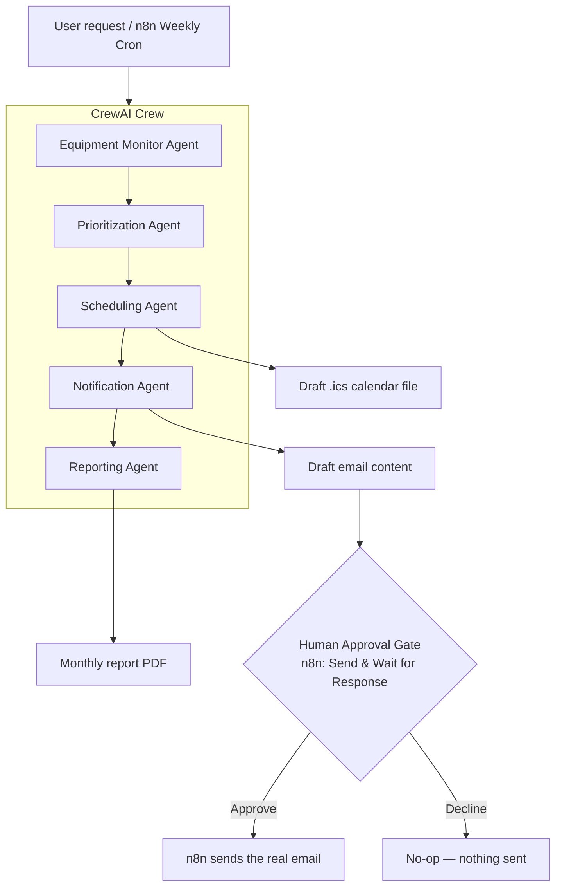
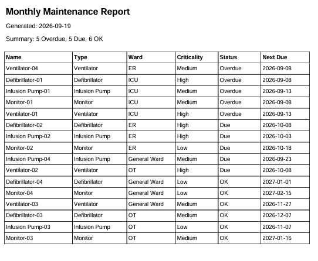
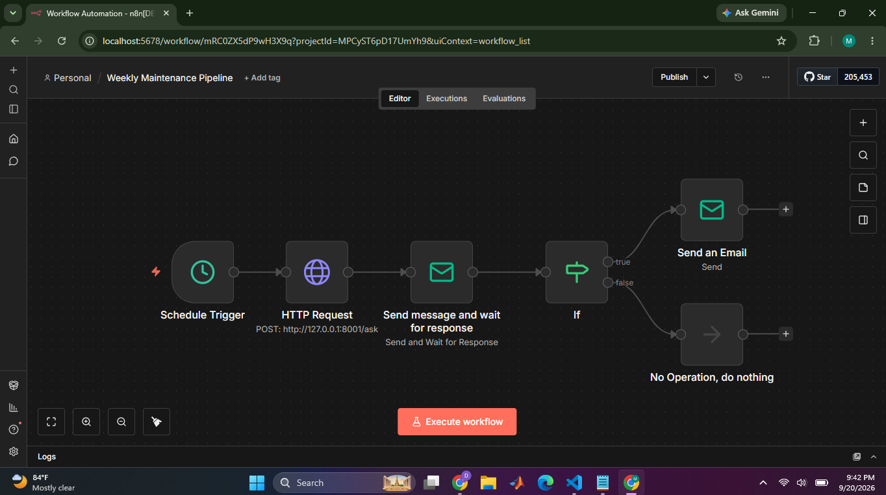
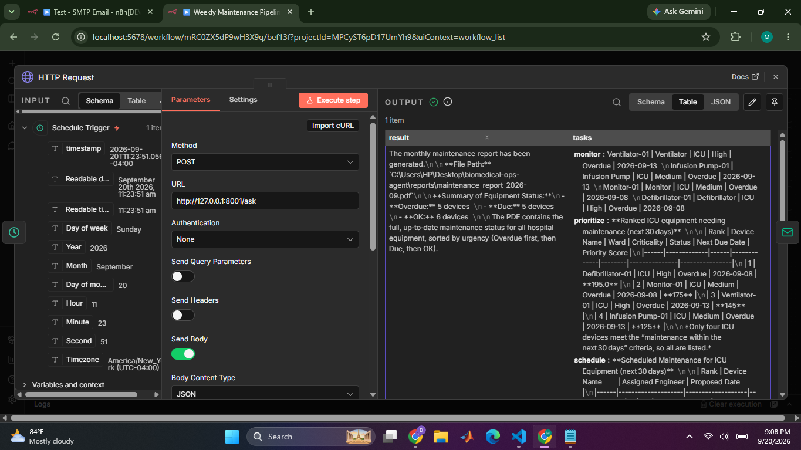
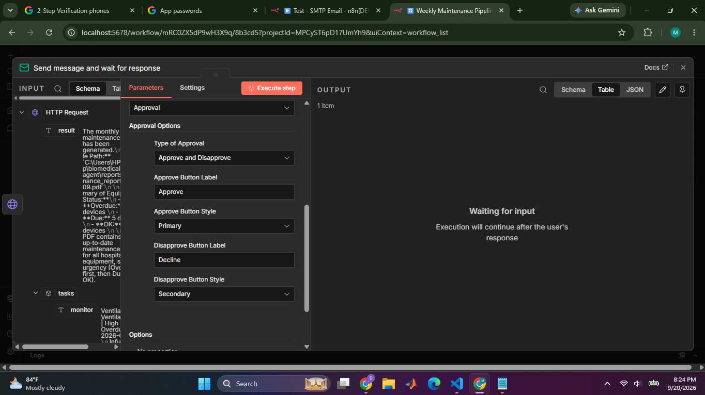
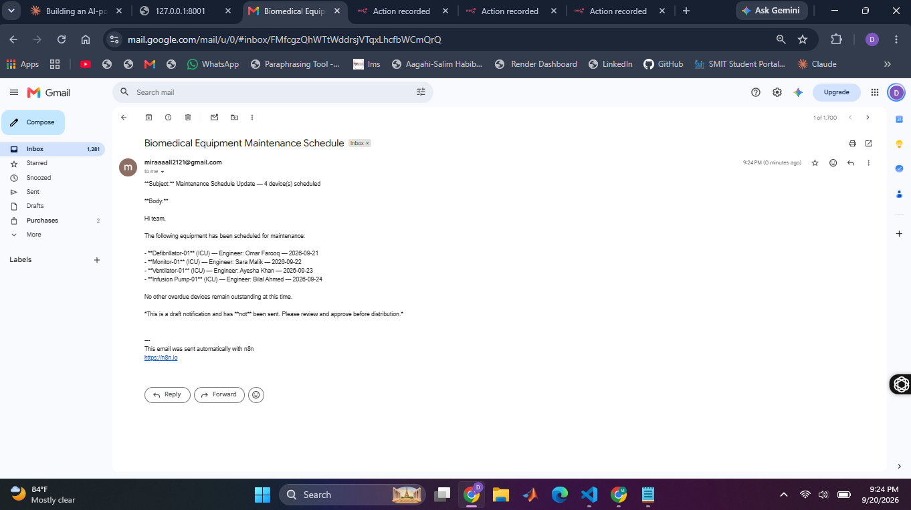
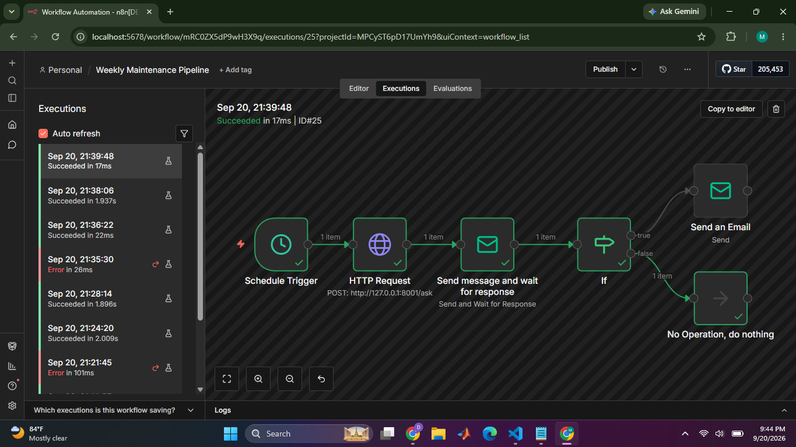
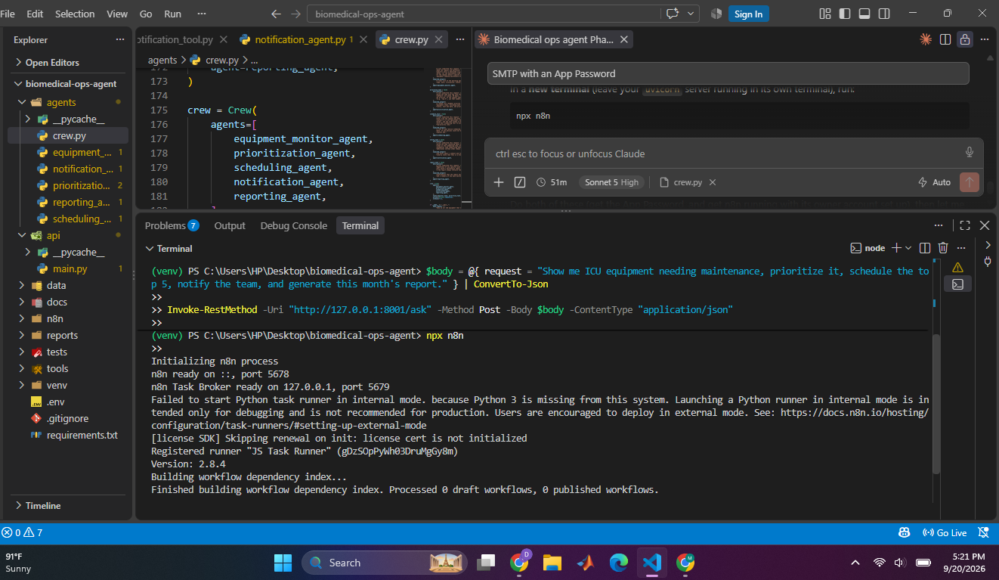
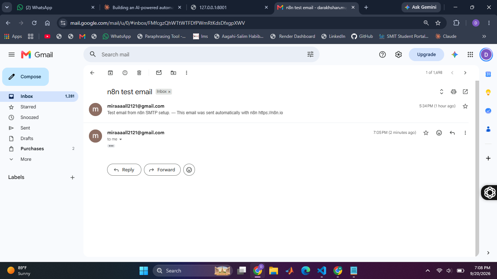

# 🏥 Biomedical Equipment Operations Agent

An **agentic AI system** for a hospital's biomedical engineering department. It finds
equipment due for maintenance, prioritizes it by real risk, proposes a schedule, drafts a
team notification, and generates a compliance report — with a **mandatory human-approval
step** before anything is ever actually sent or scheduled.

Built as a combined **"Personal AI Assistant with Tools"** + **"Automated Reporting Agent
System"** — the AI doesn't just chat, it decides which tool to call, with what parameters,
and hands off to a human before touching the real world.

<p align="left">
  
  
  
  
  
  
</p>

---

## Table of contents

- [Why this exists](#why-this-exists)
- [How it works](#how-it-works)
- [Features](#features)
- [Tech stack](#tech-stack)
- [Project structure](#project-structure)
- [Getting started](#getting-started)
- [Running it](#running-it)
- [Human approval, concretely](#human-approval-concretely)
- [Demo](#demo)
- [Known limitations & roadmap](#known-limitations--roadmap)
- [License](#license)

---

## Why this exists

Hospitals manage large fleets of biomedical equipment (ventilators, infusion pumps,
monitors, defibrillators) with maintenance tracked manually in spreadsheets. That causes:

- Missed or delayed preventive maintenance → equipment failure risk in ICU/OT
- No prioritization logic — engineers don't know what's most urgent this week
- Slow, manual communication between engineering and equipment users
- No automated audit trail for compliance reviews

This project automates that entire workflow — while keeping a human in the loop for
anything irreversible. Full problem statement in [`docs/01_project_scope.md`](docs/01_project_scope.md).

## How it works



Each agent reasons over the request text itself to infer its own parameters (ward,
time window, how many items) — nothing is regex-extracted in advance. What's fixed is
*which* agents run and in what order; *how* each one interprets the request is genuine
LLM reasoning.

**The one rule everything else follows:** any tool that could cause a real-world side
effect (sending an email, creating a calendar event) only ever produces a *draft*. Only
n8n, after an explicit human click, performs the real send.

## Features

- 🔍 **Agentic tool use** — the LLM decides which function to call and with what
  arguments, based on natural language, not hardcoded logic
- 🧮 **Deterministic risk scoring** — priority = `f(overdue days, criticality, usage
  hours)`, computed in auditable Python, not left to LLM arithmetic (see
  [`tools/prioritization_tool.py`](tools/prioritization_tool.py) for the exact formula
  and the edge cases it was built to survive)
- 🗓️ **Real scheduling constraints** — engineers are matched by specialty and
  availability, never double-booked on the same day
- ✅ **Human-in-the-loop, for real** — every notification is drafted, never sent, until
  a person clicks Approve in an actual email
- 🔁 **Fully automatable** — a weekly cron trigger in n8n runs the entire pipeline with
  zero manual prompting
- 🧪 **Every layer independently testable** — tools, agents, the full crew, and the API
  can each be run and verified standalone

## Tech stack

| Layer | Technology | Why |
|---|---|---|
| LLM inference | Groq (`openai/gpt-oss-120b`, OpenAI-compatible endpoint) | Fast, free-tier, no local GPU needed |
| Agent framework | CrewAI | Agent/Task/Crew abstraction, tool-calling built in |
| Database | SQLite | Zero setup, file-based, plenty for this scale |
| API | FastAPI | Single `/ask` integration point for CLI + n8n |
| PDF reports | fpdf2 | Lightweight, pure-Python |
| Calendar drafts | `ics` | Generates standard `.ics` files, no OAuth needed |
| Automation | n8n (`npx n8n`) | Cron scheduling, SMTP email, built-in approval-gate node |
| Approval gate | n8n "Send and Wait for Response" | Real pause/resume via webhook, no manual polling |

Full rationale in [`docs/02_tech_stack.md`](docs/02_tech_stack.md).

## Project structure

```
agents/     CrewAI agent definitions + the combined 5-agent crew (crew.py)
tools/      Pure Python tool functions — SQL, PDF, calendar, email, scheduling, priority
api/        FastAPI app exposing POST /ask
data/       SQLite schema, seed script, and the database file
docs/       Planning docs (scope, tech stack, architecture, implementation plan)
n8n/        Exported n8n workflow(s)
reports/    Generated PDFs and .ics files (gitignored)
tests/      Reserved for future test coverage
```

## Getting started

```bash
python -m venv venv
venv\Scripts\activate            # Windows
python -m pip install -r requirements.txt
```

Create a `.env` file in the project root:

```
GROQ_API_KEY=your_key_here
CREWAI_TRACING_ENABLED=false
```

Initialize and seed the database (seed data uses dates relative to *today*, so it stays
realistic no matter when you run it):

```bash
python data/init_db.py
python data/seed_data.py
```

## Running it

<details>
<summary><strong>Individual tools</strong> (each testable standalone, no LLM calls)</summary>

```bash
python tools/sql_tool.py
python tools/pdf_tool.py
python tools/calendar_tool.py
python tools/email_tool.py
python tools/prioritization_tool.py
python tools/scheduling_tool.py
python tools/notification_tool.py
```
</details>

<details>
<summary><strong>Individual agents</strong> (one agent + one task each, real LLM calls)</summary>

```bash
python agents/equipment_monitor_agent.py
python agents/prioritization_agent.py
python agents/scheduling_agent.py
python agents/reporting_agent.py
python agents/notification_agent.py
```
</details>

<details>
<summary><strong>Full 5-agent pipeline</strong> (CLI)</summary>

```bash
python agents/crew.py
```
</details>

<details>
<summary><strong>API layer</strong></summary>

```bash
uvicorn api.main:app --reload --port 8001
```

```bash
curl -X POST http://127.0.0.1:8001/ask \
  -H "Content-Type: application/json" \
  -d '{"request": "Show me ICU equipment needing maintenance, prioritize it, schedule the top 5, notify the team, and generate this month'\''s report."}'
```
</details>

<details>
<summary><strong>Automation (n8n)</strong></summary>

```bash
npx n8n
```

Import the workflow from `n8n/`, configure your own SMTP credential (a Gmail App
Password works well — no OAuth app registration needed), and either run it manually or
activate it for the weekly schedule.
</details>

## Human approval, concretely

The n8n workflow: **Schedule Trigger → HTTP Request (`/ask`) → Send email & wait for
response (Approve/Decline) → IF branch → real send (Approve) or no-op (Decline)**.

Nothing reaches a real inbox without an explicit click — verified end-to-end for both
the approve and reject paths, including n8n's execution history as proof of which
branch actually fired on each run.

## Demo

**Monthly maintenance report**, sorted by urgency (Overdue → Due → OK):



**The full n8n automation workflow** — weekly cron trigger → 5-agent pipeline → human
approval gate → real send or safe no-op:



**The `/ask` endpoint returning every agent's output**, not just the final one — this is
what feeds the approval email's content:



**The human-approval email itself**, with real Approve/Decline buttons wired to n8n's
webhook resume mechanism:



**The real notification**, sent only after clicking Approve:



**Proof the reject path is actually safe** — n8n's own execution history showing the
`false` branch fired and the real send never happened:



<details>
<summary>More screenshots (n8n running locally, SMTP verification)</summary>




</details>

## Known limitations & roadmap

- Task routing within the crew is fixed (find → prioritize → schedule → notify →
  report); each agent still reasons about *parameters* from the request text, but
  doesn't dynamically skip steps. `Process.hierarchical` with a manager agent would
  close this gap — a planned next step, not yet implemented.
- `.ics` timestamps are UTC per the standard; no real-world timezone handling.
- Uses mock/seed data only, by design — no real hospital data is used or required.
- Gmail sending currently uses SMTP + App Password rather than OAuth2; fine for a demo,
  OAuth would be the production-grade choice.

## License

Built as an educational/portfolio project. Feel free to add a `LICENSE` file (MIT is a
common permissive choice) if you plan to open-source it formally.
