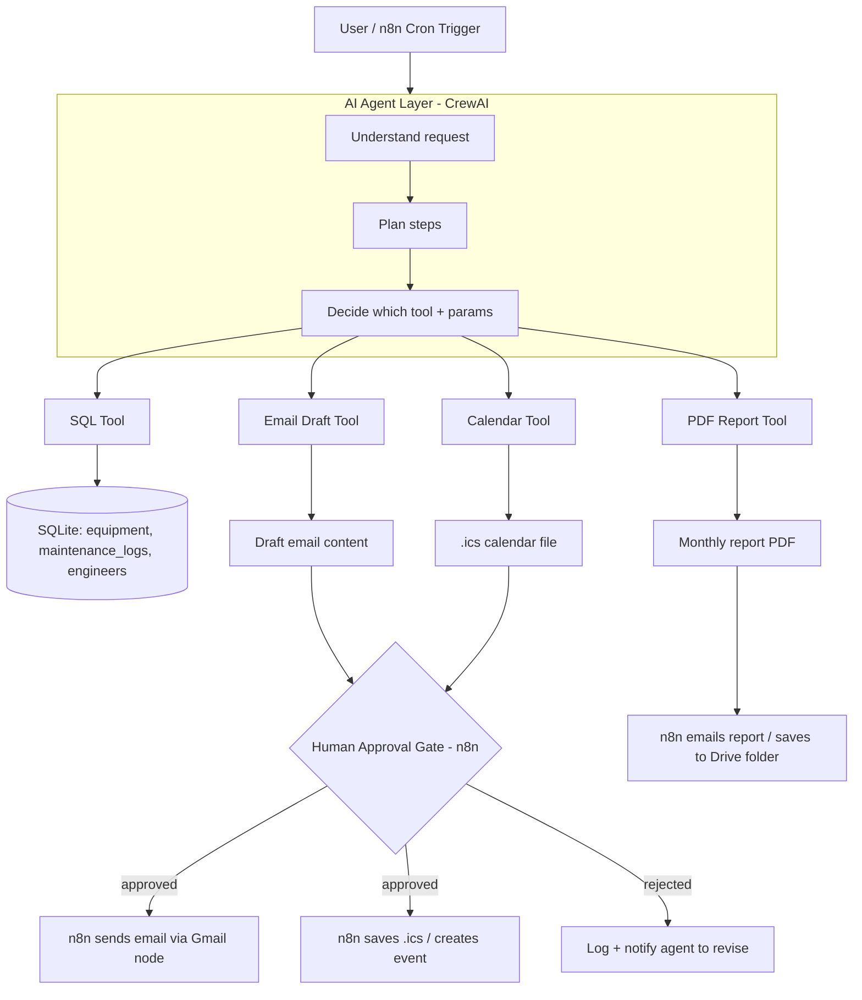

# System Architecture

## 1. High-Level Diagram

## 2. Component Breakdown

### Agent Layer (CrewAI) — `agents/`
| Agent | Role | Tools It Uses |
|---|---|---|
| **Equipment Monitor Agent** | Finds equipment due/overdue for maintenance, filters by ward/criticality | SQL Tool |
| **Prioritization Agent** | Scores and ranks equipment by risk (overdue days × criticality × usage hours) | SQL Tool |
| **Scheduling Agent** | Proposes maintenance slots and engineer assignments | Calendar Tool, SQL Tool |
| **Reporting Agent** | Builds the monthly/weekly maintenance report | SQL Tool, PDF Tool |
| **Notification Agent** | Drafts the email to the biomedical team (does NOT send it) | Email Draft Tool |

These are wired together as a **CrewAI Crew** with sequential/hierarchical tasks — the orchestration script decides which agents run based on the user's request.

### Tool Layer — `tools/`
- `sql_tool.py` — parametrized read/write queries against SQLite (equipment, maintenance_logs, engineers tables).
- `calendar_tool.py` — generates `.ics` files for proposed maintenance slots.
- `email_tool.py` — formats email subject/body (returns a draft object, never sends).
- `pdf_tool.py` — builds the maintenance report PDF using fpdf2.

**Key design rule:** tools that cause a real-world side effect (send email, create calendar event) are *not allowed to execute directly from the agent*. They only produce a **draft/proposal object**. Only n8n, after human approval, performs the actual send/create. This is what makes the human-approval gate real instead of decorative.

### Data Layer — SQLite (`data/equipment.db`)
- `equipment` (id, name, type, ward, criticality, usage_hours, install_date)
- `maintenance_logs` (id, equipment_id, last_service_date, next_due_date, status)
- `engineers` (id, name, specialty, availability)

### Automation Layer — n8n workflows (`n8n/`)
1. **Trigger workflow** — Cron (e.g. every Monday 8AM) OR manual webhook — calls the FastAPI `/ask` endpoint.
2. **Human approval workflow** — receives the agent's draft (email/schedule), sends it to Darakhshan via email/Telegram with an Approve/Reject link (n8n "Wait for Webhook" node), pauses until she responds.
3. **Execution workflow** — on approval, sends the real email (Gmail node) and/or saves the `.ics` file; on rejection, logs it and stops.

### API Layer — FastAPI (`api/main.py`)
- `POST /ask` — takes a natural-language request, runs the CrewAI crew, returns the result/draft as JSON. This is the single integration point both a CLI demo and n8n use.

## 3. End-to-End Example Flow

> "Show me all ICU equipment that needs maintenance within the next 30 days, prioritize it, schedule the top 5, notify the team, and generate this month's report."

1. FastAPI receives the request → CrewAI Crew kicks off.
2. **Equipment Monitor Agent** → SQL Tool → filters ICU + due-within-30-days.
3. **Prioritization Agent** → ranks by risk score.
4. **Scheduling Agent** → picks top 5 → Calendar Tool → produces a draft `.ics` + engineer assignments.
5. **Notification Agent** → Email Tool → drafts a summary email (not sent yet).
6. **Reporting Agent** → PDF Tool → builds the monthly report.
7. FastAPI returns: `{ schedule_draft, email_draft, report_pdf_path }`.
8. n8n picks this up → sends the drafts to Darakhshan for **approval**.
9. On approval → n8n sends the real email + saves the calendar file + emails the PDF report.
10. Everything is logged (who approved, when, what was sent) for auditability.

## 4. Why This Is "Agentic" (not just a chatbot)

At each step the LLM is making a **decision**, not just generating text:
- *Which tool do I need?* (SQL vs Calendar vs Email vs PDF)
- *What parameters does it need?* (ward="ICU", days=30)
- *What do I do with the result?* (pass ranked list to Scheduling Agent)
- *Does this need human approval before it happens in the real world?* (yes, always, for send/schedule actions)
